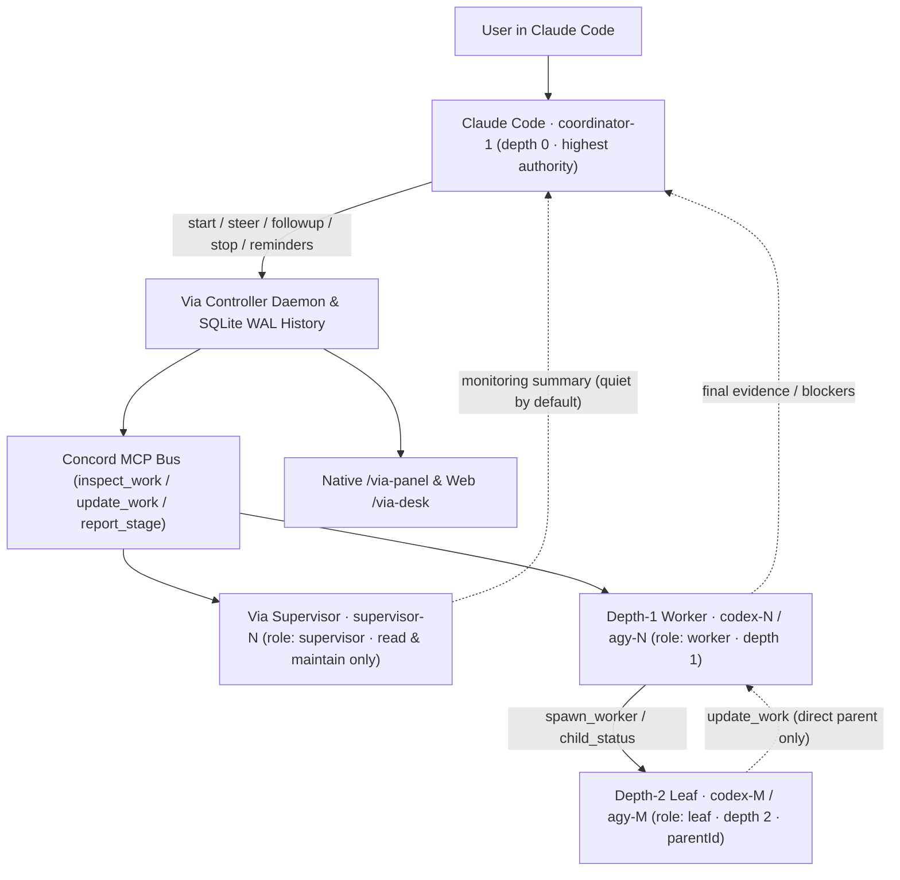

# Via Multi-Agent (`via`)

English | [中文文档](./README_ZH.md) | [Architecture Guide](./docs/ARCHITECTURE.md)

A local Claude Code plugin for orchestrating **Codex** (`codex app-server`) and **Antigravity** (`agy acp`) subagents through [Concord](https://github.com/Get-Concord-AI/concord-mcp), featuring a scoped **Via Supervisor** (`supervisor-<N>`), tracked two-layer delegation, quiet-by-default reporting, a native side panel (`/via-panel`), and a local web communication desk (`/via-desk`).

> Built on top of Sean Floyd's MIT-licensed [via (`SeanLF/claude-code-subagent-harnesses`)](https://github.com/SeanLF/claude-code-subagent-harnesses), adapted and stripped of machine-specific paths, credentials, and hardcoded proxies for clean public reuse.

---

## Architecture



---

## Key Features

- **4-Role Hierarchy with Strict Boundaries**
  - **Coordinator (`coordinator-1`, `depth: 0`)**: Claude Code owns direction, approvals, explicit `stop` authority (`stoppedByCoordinator`), and final acceptance.
  - **Supervisor (`supervisor-<N>`, `role: 'supervisor'`)**: Automatically monitors active groups from real lifecycle events (turn failures, unexpected interruptions, explicit stall watchdog, and completion review) using scoped tools (`group_status`, `group_history`, `group_list`, `steer_worker`, `followup_worker`, `stop_worker`). Cannot spawn workers and never restarts workers explicitly stopped by Claude.
  - **Depth-1 Workers (`codex-<N>` / `agy-<N>`, `role: 'worker'`, `depth: 1`)**: Peer-to-peer collaboration via Concord; may spawn up to 6 depth-2 leaves strictly through Via's `spawn_worker`. Codex native multi-agent flags (`multi_agent`, `multi_agent_v2`, `agents.enabled`) are disabled so every child subagent registers inside Via.
  - **Depth-2 Leaves (`role: 'leaf'`, `depth: 2`)**: Registered in Via, Concord (`parent_task_id`), History, `/via-panel`, and `/via-desk` with `[叶代理 ← parentId]`. Restricted to messaging only their direct parent and blocked from spawning further subagents.
- **Full Permissions by Default**: New, resumed, delegated leaf, and supervisor workers default to `permissions: 'full'` unless `permissions: 'restricted'` is explicitly passed.
- **Quiet-by-Default Coordinator Reporting**: Messages sent to `coordinator-*` stay queued in the message box (`coordinator_inbox`, `list`, `/via-panel`, `/via-desk`) without waking Claude turns. Use `reminders({ action: 'open' })` whenever you want push notifications enabled.
- **Optional OpenAI-Compatible AI Summaries**: Enable `VIA_SUMMARY_ENABLED=1` with any OpenAI-compatible `/chat/completions` endpoint to enrich Concord messages in `list`, `history`, `coordinator_inbox`, `/via-panel`, and `/via-desk`.
- **Native UI & Local Web Desk**: Use `/via-panel` inside Claude Code or `/via-desk` for a localhost Honeycomb graph, live/historical replay, delivery receipt tracking (`queued` -> `delivered` -> `read` -> `replied`), and member role inspection.

---

## Requirements & Platform Support

- **OS**: **macOS** (Concord sandboxing currently invokes `/usr/bin/sandbox-exec`, and desktop folder selection / notifications use `osascript`)
- **Runtime**: **Node.js `>= 22.18.0`** (uses built-in `node:sqlite` and `node:test`)
- **Worker CLIs**: At least one installed and signed-in local CLI on `PATH` (or configured via `VIA_CODEX` / `VIA_AGY`):
  - [Codex CLI](https://github.com/openai/codex) (`codex`)
  - [Antigravity CLI](https://github.com/google-antigravity/antigravity-cli) (`agy`)

---

## Quick Start

1. **Clone & install dependencies**:

```sh
git clone https://github.com/xu12329/via-multi-agent.git
cd via-multi-agent
npm install
```

2. **Load into Claude Code** (from local marketplace or plugin directory):

```sh
claude plugin marketplace add ./
claude plugin install via@via-multi-agent
```

   Or point `claude --plugin-dir /path/to/via-multi-agent` when launching Claude Code for testing.

3. **Open the built-in views inside Claude Code**:
   - `/via-panel` — open the side pane to inspect tasks, role tags (`[监管]`, `[叶代理 ← ...]`), AI summaries, and delivery receipts, or dispatch/steer workers.
   - `/via-desk` — open the local web communication desk in your browser.

---

## MCP Tools Reference

### Top-Level Coordinator (`workers` server)
| Tool | Purpose |
|---|---|
| `start` | Start a `codex` or `agy` worker (`group`, `cwd`, `prompt`, optional `model`, `effort`, `session`, `permissions`, `activation: 'concord'`, `requestId`). |
| `steer` / `followup` / `stop` | Inject live steering into an active turn, continue an idle/completed session, or stop a worker cleanly. |
| `board` / `history` / `status` | Read live group state, SQLite WAL event history, or single-worker details and approvals. |
| `list` / `coordinator_inbox` / `peer_read` | Inspect recent group mail (`list`), consume messages addressed to `coordinator-*` (`coordinator_inbox`), or peek unread peer mail. |
| `reminders` | Toggle push reminders to Claude (`action: 'open' \| 'close' \| 'status'`, optional `desktop: boolean`). Off by default. |
| `models` / `review_approval` | Query native Codex/AGY model catalogs without starting a turn, or resolve pending restricted-mode approvals. |

### Worker & Supervisor Concord Tools
- **All workers**: `inspect_work` (no args = peer discovery with `role`/`depth`/`parentId`; `{ agent_id }` = consume own inbox), `update_work` (`prompt` / `reply`), `report_stage` (`saved` / `blocked`).
- **Depth-1 non-supervisor workers only**: `spawn_worker`, `child_status`.
- **Supervisor (`supervisor-<N>`) only**: `group_status`, `group_history`, `group_list`, `steer_worker`, `followup_worker`, `stop_worker`.

---

## Environment Variables

| Variable | Default | Description |
|---|---|---|
| `VIA_WORKSPACE` | `process.cwd()` | Root directory boundary for worker `cwd` scoping (can also be stored in `~/.config/via-desk/workspace`). |
| `VIA_CODEX` | auto-detected on `PATH` | Explicit path to the `codex` executable. |
| `VIA_AGY` | auto-detected on `PATH` | Explicit path to the `agy` executable. |
| `VIA_AGY_SETUP` | unset | Optional zsh wrapper script defining an `agy()` function before launching ACP. |
| `VIA_PROXY` | unset | Optional HTTP/HTTPS proxy URL passed to Codex worker processes (`HTTP_PROXY`, `HTTPS_PROXY`, `ALL_PROXY`). |
| `VIA_NO_PROXY` | `localhost,127.0.0.1,::1` | Comma-separated bypass list when `VIA_PROXY` is set. |
| `VIA_CODEX_DEFAULT_MODEL` | CLI configured default | Optional default Codex model when `start` omits `model`. |
| `VIA_CODEX_DEFAULT_EFFORT` | model default / `xhigh` | Optional default Codex reasoning effort. |
| `VIA_SUPERVISOR_MODEL` | Codex default | Optional model override for `supervisor-<N>` (defaults to Codex CLI config). |
| `VIA_SOL_SUPERVISION` | enabled (`off` to disable) | Set to `off` to disable automatic background supervisor waking. |
| `VIA_CODEX_PERSIST_THREADS` | ephemeral in Claude scope | Set to `1` to keep Codex threads persistent across `stop` / `followup`. |
| `VIA_SUMMARY_ENABLED` | disabled (`1` to enable) | Enable AI summaries on Concord messages. |
| `VIA_SUMMARY_BASE_URL` | unset | OpenAI-compatible base URL (`https://...` or loopback `http://`). |
| `VIA_SUMMARY_API_KEY` | unset | Bearer token for `VIA_SUMMARY_BASE_URL`. |
| `VIA_SUMMARY_MODEL` | unset | Model ID sent to `VIA_SUMMARY_BASE_URL`. |

---

## Troubleshooting

- **Panel shows "无法读取 Via 任务" after resuming a Claude session**: Run `/mcp` in Claude Code and reconnect only `plugin:via:workers`.
- **Codex worker needs `followup` after `stop`**: By default in Claude-scoped sessions, Codex workers start as ephemeral threads so they don't clutter desktop thread lists; start a fresh worker or set `VIA_CODEX_PERSIST_THREADS=1`.
- **Network proxy needed for Codex workers**: Set `VIA_PROXY=http://127.0.0.1:<port>` in your plugin `env` rather than hardcoding URLs in code.

---

## Testing

```sh
npm test
```

Runs the full `node --test local/*.test.mjs` suite (61 tests covering server architecture, Concord messaging & isolation, 2-layer delegation, supervisor crash/stall recovery, `/via-panel`, `/via-desk` singleton behavior, selection logic, and summary providers).

---

## License & Attribution

- **License**: [MIT License](./LICENSE)
- **Upstream**: [SeanLF/claude-code-subagent-harnesses](https://github.com/SeanLF/claude-code-subagent-harnesses) (`Copyright (c) 2026 Sean Floyd`)
- **Concord MCP**: [`@concord-ai/concord-mcp`](https://github.com/Get-Concord-AI/concord-mcp) (MIT License)
