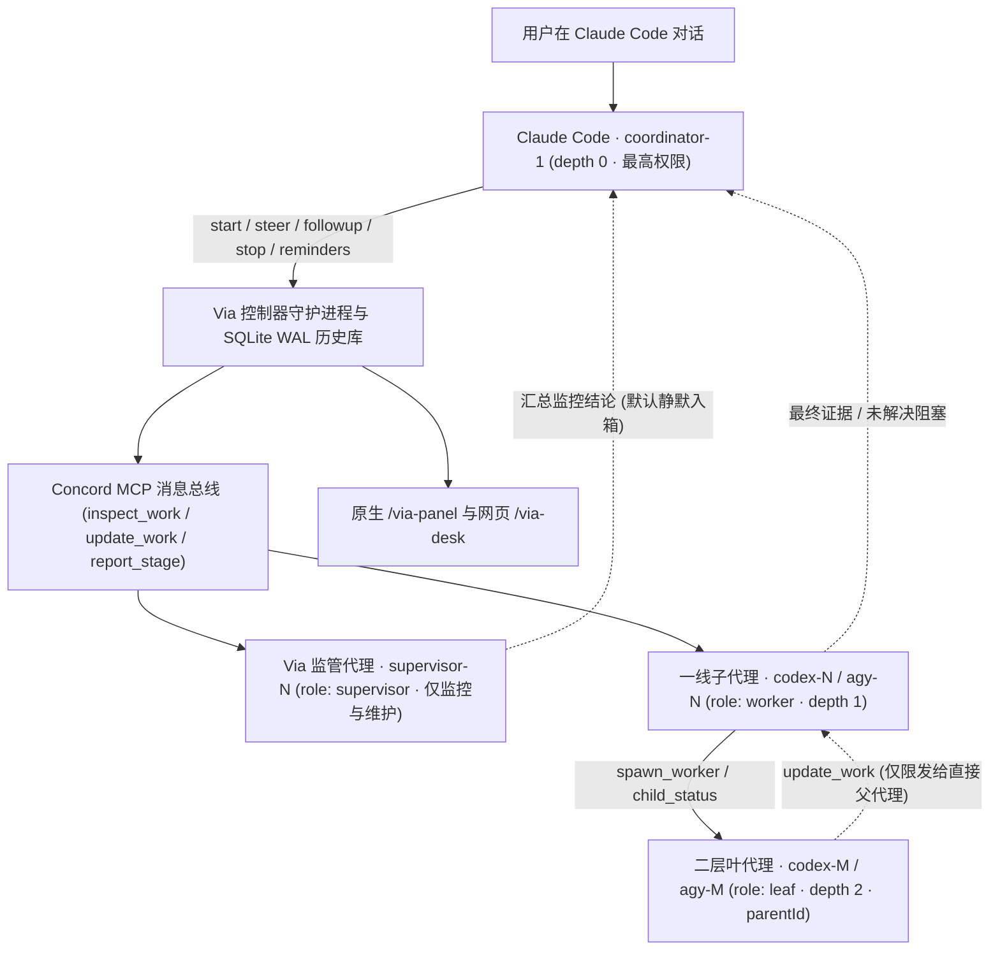

# Via Multi-Agent (`via`)

[English](./README.md) | 中文文档 | [架构与协议说明](./docs/ARCHITECTURE.md)

一个用于 **Claude Code** 的本地多代理编排插件：通过 [Concord](https://github.com/Get-Concord-AI/concord-mcp) 协调本地已登录的 **Codex**（`codex app-server`）与 **Antigravity**（`agy acp`）子代理，内置独立命名的监管代理 **Via Supervisor**（`supervisor-<N>`）、严格追踪的二层子代理下派、默认静默汇报机制，以及原生的 `/via-panel` 侧边栏与 `/via-desk` 本地网页通信桌。

> 本仓库基于 Sean Floyd 开源的 [via (`SeanLF/claude-code-subagent-harnesses`)](https://github.com/SeanLF/claude-code-subagent-harnesses)（MIT License）进行工程化重构，并已移除本机硬编码路径、代理端口、私人摘要配置及个人主题素材。

---

## 核心架构



---

## 核心特性

1. **四层明确角色与边界约束**
   - **协调者（`coordinator-1`, `depth: 0`）**：由 Claude Code 本身担任，掌握任务方向、权限审批、强制终止（`stoppedByCoordinator`）与最终验收的最高权限。
   - **监管代理（`supervisor-<N>`, `role: 'supervisor'`）**：基于真实生命周期事件（回合异常、意外中断、超时看门狗、全组完成复核）自动唤醒，使用专属监控/维护工具（`group_status`、`group_history`、`group_list`、`steer_worker`、`followup_worker`、`stop_worker`）。禁止下派子代理，且绝不重启已被 Claude 显式停止的成员。
   - **一线子代理（`codex-<N>` / `agy-<N>`, `role: 'worker'`, `depth: 1`）**：可通过 Concord 点对点协作，并可通过 Via 的 `spawn_worker` 下派最多 6 个二层叶代理。所有 Via 托管的 Codex 实例都会禁用原生多代理开关（`multi_agent=false`、`multi_agent_v2=false`、`agents.enabled=false`），确保所有子代理都在 Via 内注册并受控。
   - **二层叶代理（`role: 'leaf'`, `depth: 2`）**：自动在 Via、Concord（带 `parent_task_id`）、历史库、`/via-panel`（显示 `[叶代理 ← parentId]`）与 `/via-desk` 注册。仅允许向自己的直接父代理汇报，不允许直接联系协调者或其他同级成员，也不允许继续下派子代理。

2. **默认全权限运行（`permissions: 'full'`）**
   - 新建、恢复（`resume`）、二层叶代理以及监管代理默认以 `'full'` 权限启动，只有显式传入 `permissions: 'restricted'` 时才启用沙箱与逐项审批。

3. **默认静默向 Claude 汇报（按需开启提醒）**
   - 发给 `coordinator-*` 的汇报消息默认只写入消息箱，可通过 `coordinator_inbox`、`list`、`/via-panel` 或 `/via-desk` 查看，**不会打断或直接唤醒 Claude 回合**。
   - 如需恢复主动推送提醒，可显式调用 `reminders({ action: 'open' })`。

4. **可选的通用 AI 通信摘要**
   - 设置 `VIA_SUMMARY_ENABLED=1` 并配置任意 OpenAI 兼容接口（`VIA_SUMMARY_BASE_URL`、`VIA_SUMMARY_API_KEY`、`VIA_SUMMARY_MODEL`），即可在消息产生后自动生成摘要并回填到 `list`、`history`、`coordinator_inbox`、`/via-panel` 与 `/via-desk`。

5. **双界面可观测性（`/via-panel` + `/via-desk`）**
   - `/via-panel`：直接在 Claude Code 侧边查看组内成员、角色标签（`[监管]`、`[叶代理 ← ...]`）、AI 摘要与真实送达回执（`queued` / `delivered` / `read` / `replied`），并可派单、插话与续聊。
   - `/via-desk`：在本地浏览器打开多代理通信桌，支持蜂巢关系图、实时状态、历史时间线回放及角色/层级检查。

---

## 环境要求

- **操作系统**：**macOS**（Concord 沙箱当前调用 `/usr/bin/sandbox-exec`，桌面目录选择器与系统通知使用 `osascript`）
- **Node.js**：**`>= 22.18.0`**（使用内置 `node:sqlite` 与 `node:test`）
- **本地 Worker CLI**（至少安装并登录其中之一，确保在 `PATH` 中或通过环境变量指定）：
  - [Codex CLI](https://github.com/openai/codex)（`codex`）
  - [Antigravity CLI](https://github.com/google-antigravity/antigravity-cli)（`agy`）

---

## 快速开始

1. **克隆并安装依赖**

```sh
git clone https://github.com/xu12329/via-multi-agent.git
cd via-multi-agent
npm install
```

2. **在 Claude Code 中加载插件**

```sh
claude plugin marketplace add ./
claude plugin install via@via-multi-agent
```

   或在启动 Claude Code 时直接指定插件目录进行测试：

```sh
claude --plugin-dir /path/to/via-multi-agent
```

3. **常用命令**
   - `/via-panel`：打开 Claude Code 原生任务与消息面板
   - `/via-desk`：打开本地网页通信桌

---

## 环境变量说明

| 变量名 | 默认值 | 用途说明 |
|---|---|---|
| `VIA_WORKSPACE` | `process.cwd()` | 限制子代理工作目录根边界（也可写入 `~/.config/via-desk/workspace`）。 |
| `VIA_CODEX` | 自动从 `PATH` 查找 | 指定 `codex` 可执行文件绝对路径。 |
| `VIA_AGY` | 自动从 `PATH` 查找 | 指定 `agy` 可执行文件绝对路径。 |
| `VIA_AGY_SETUP` | 未设置 | 可选的 zsh 初始化脚本（需定义 `agy()` 封装函数后再启动 ACP）。 |
| `VIA_PROXY` | 未设置 | 可选的 Codex 子进程代理地址（设置后会注入 `HTTP_PROXY` / `HTTPS_PROXY` / `ALL_PROXY`）。 |
| `VIA_NO_PROXY` | `localhost,127.0.0.1,::1` | 启用 `VIA_PROXY` 时的直连白名单。 |
| `VIA_CODEX_DEFAULT_MODEL` | 跟随 Codex CLI 配置 | 未显式传 `model` 时的默认 Codex 模型。 |
| `VIA_CODEX_DEFAULT_EFFORT` | 模型默认或 `xhigh` | 未显式传 `effort` 时的默认推理强度。 |
| `VIA_SUPERVISOR_MODEL` | 跟随 Codex 默认模型 | 覆盖监管代理 `supervisor-<N>` 使用的模型。 |
| `VIA_SOL_SUPERVISION` | 开启（设 `off` 关闭） | 设为 `off` 时关闭后台自动监管唤醒。 |
| `VIA_CODEX_PERSIST_THREADS` | Claude 作用域内默认临时线程 | 设为 `1` 可让 Codex 会话在 `stop` 后仍可被 `followup` 重开。 |
| `VIA_SUMMARY_ENABLED` | 关闭（设 `1` 开启） | 启用消息后的 AI 摘要生成。 |
| `VIA_SUMMARY_BASE_URL` | 未设置 | OpenAI 兼容接口地址（需为 `https://` 或本机回环 `http://`）。 |
| `VIA_SUMMARY_API_KEY` | 未设置 | 摘要接口的 Bearer API Key。 |
| `VIA_SUMMARY_MODEL` | 未设置 | 传给摘要接口的模型 ID。 |

---

## 测试

运行完整本地测试套件（共 61 项测试）：

```sh
npm test
```

---

## 开源协议与致谢

- 协议：[MIT License](./LICENSE)
- 上游项目：[SeanLF/claude-code-subagent-harnesses](https://github.com/SeanLF/claude-code-subagent-harnesses)（`Copyright (c) 2026 Sean Floyd`）
- 代理间消息与状态总线：[`@concord-ai/concord-mcp`](https://github.com/Get-Concord-AI/concord-mcp)（MIT License）
